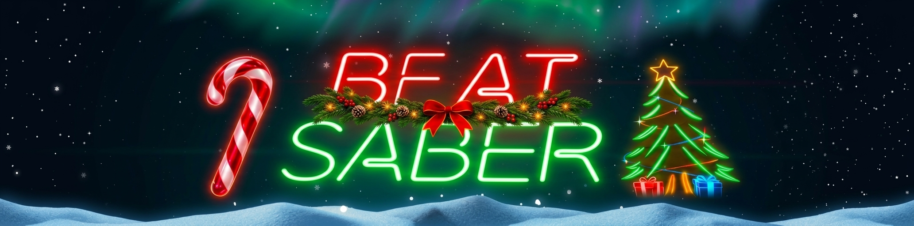

# Christmas Eve v1.0.0 🎄 — Beat Saber Quest 1.40.8

Celebrate Christmas Eve on a peaceful, snowy alpine winter night.

**Status:** Public source, selected artwork, and four Ogg audio files are present in this repository. **No public QMOD release is attached.** The audio remains subject to the separate licenses and unresolved redistribution questions documented in [MUSIC_LICENSES.md](MUSIC_LICENSES.md). Private Build #129 was reported working on Quest; this public source and any new verification build are **not** independently Quest-tested.

## Features

- Festive red-and-green BEAT SABER neon logo, including the preserved custom E artwork.
- Evergreen garland and warm-gold sparkles, candy cane, decorated tree and presents.
- Snowy alpine panorama, foreground snowdrifts and layered falling snow.
- Three Christmas menu music tracks, with one track selected per menu-music session.
- Three gently animated PNG-backed aurora bands on the results screen **only** for S, SS or SSS rank, with a one-shot bell jingle.
- S/SS/SSS aurora results suppress firework particles, explosion sounds and firework-associated light flashes. Lower ranks retain their existing behavior.
- Original Christmas Eve environment lighting (no experimental midnight/emerald menu recoloring).

Compatible with **Beat Saber Quest 1.40.8_7379**. Internal mod ID: `christmas`; QMOD version: **1.0.0**.

## Authors and attribution

Christmas Eve builds upon the original Christmas Theme by **CatsaCode and laynia**, preserving the original snowdrift contributions of **Furzz and Laynia**. Original project documentation is retained in [upstream/README.md](upstream/README.md). Source licensing remains **GPL-3.0**.

For code and dependency credits, see [THIRD_PARTY_NOTICES.md](THIRD_PARTY_NOTICES.md). For complete audio credits and redistribution status, see [MUSIC_LICENSES.md](MUSIC_LICENSES.md). **Credits alone do not resolve permissions for technically extractable bundled files.**

## Source layout and builds

- `src/`, `include/` — C++ implementation and headers.
- `assets/` — selected PNG artwork and settings used by the build.
- `cmake/`, `scripts/`, `qpm.json`, `qpm.shared.json`, `CMakeLists.txt`, `assets.cmake`, `mod.template.json` — build and packaging files.
- `FileCopies/` — four included Ogg soundtrack/effect files referenced by `mod.template.json`.
- `upstream/README.md` — retained original-project credits.

Private manual Build **#131** succeeded at release-candidate commit `b15acb86473c518a73f12413a8f68e30344fd9f8`. The public source was independently organized and committed without the private Git history. Source/build-critical files were previously compared to that candidate, but a new public compilation and package inspection are needed to establish the status of this repository's own build. **Do not represent a verification build as separately Quest-tested.**

## Licensing and distribution

The project's covered source code is distributed under [GPLv3](LICENSE). Audio and other third-party content retain separate licensing terms. The four Ogg files are currently present in public Git history, but their presence is **not** a statement that every underlying redistribution right has been independently verified. See [MUSIC_LICENSES.md](MUSIC_LICENSES.md). No public QMOD release is attached.
